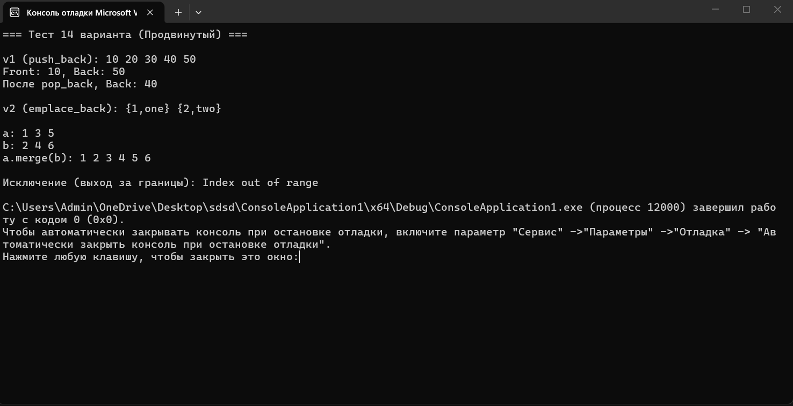

# Лабораторная работа №3
## Реализация динамического массива (аналог vector). Итераторы

**Студент:** Черников Роман Сергеевич  
**Группа:** ПИЖ-6-о-25-1  
**Дисциплина:** Алгоритмы и структуры данных  
**Вариант:** 14  
**Уровень:** Продвинутый

---

## Цель работы

1. Реализовать шаблонный класс Vector<T> - аналог std::vector - с
нуля
2. Освоить управление динамической памятью: выделение,
расширение, освобождение
3. Закрепить «правило трёх» (деструктор, конструктор копирования,
оператор присваивания) и освоить «правило пяти» (конструктор и
оператор перемещения)
4. Реализовать итераторы для поддержки range-based for и STL-
совместимости
5. Провести амортизированный анализ операции push_back

## Код программы

```cpp
#include <iostream>
#include <stdexcept>
#include <algorithm>
#include <utility>

template <typename T>
class Vector {
    T* data = nullptr;
    int sz = 0, cap = 0;
public:
    Vector() = default;
    explicit Vector(int n) : sz(n), cap(n), data(n ? new T[n]() : nullptr) {}
    
    // Правило пяти
    Vector(const Vector& o) : sz(o.sz), cap(o.cap), data(o.cap ? new T[o.cap] : nullptr) { std::copy(o.data, o.data + o.sz, data); }
    Vector(Vector&& o) noexcept : data(o.data), sz(o.sz), cap(o.cap) { o.data = nullptr; o.sz = o.cap = 0; }
    ~Vector() { delete[] data; }
    
    Vector& operator=(const Vector& o) {
        if (this != &o) { Vector t(o); std::swap(data, t.data); std::swap(sz, t.sz); std::swap(cap, t.cap); }
        return *this;
    }
    Vector& operator=(Vector&& o) noexcept {
        if (this != &o) { delete[] data; data = o.data; sz = o.sz; cap = o.cap; o.data = nullptr; o.sz = o.cap = 0; }
        return *this;
    }

    // доступ по индексу, ссылки к первому элементу и последнему
    int size() const { return sz; }
    int capacity() const { return cap; }
    bool empty() const { return sz == 0; }
    T& operator[](int i) { if (i < 0 || i >= sz) throw std::out_of_range("Index out of range"); return data[i]; }
    const T& operator[](int i) const { if (i < 0 || i >= sz) throw std::out_of_range("Index out of range"); return data[i]; }
    T& front() { if (empty()) throw std::underflow_error("Empty"); return data[0]; }
    T& back() { if (empty()) throw std::underflow_error("Empty"); return data[sz - 1]; }

    // возвращаем указатели на первые и последние элементы
    T* begin() { return data; }
    T* end() { return data + sz; }
    const T* begin() const { return data; }
    const T* end() const { return data + sz; }

    // метод расширения памяти
    void reserve(int newCap) {
        if (newCap <= cap) return;
        T* newData = new T[newCap];
        for (int i = 0; i < sz; ++i) newData[i] = std::move(data[i]);
        delete[] data; data = newData; cap = newCap;
    }

    //добавление в конец, убирание из конца
    void push_back(const T& val) {
        if (sz == cap) reserve(cap == 0 ? 1 : cap * 2);
        data[sz++] = val;
    }

    void pop_back() { if (!empty()) --sz; }

    // принимаем аргументы конструктора и строим новый объект 
    template <typename... Args>
    void emplace_back(Args&&... args) {
        if (sz == cap) reserve(cap == 0 ? 1 : cap * 2);
        new (&data[sz++]) T(std::forward<Args>(args)...);
    }

    // Сравниваем головы двух векторов и берём меньший. В конце дописываем остатки. Потом через перемещение результат становится текущим объектом. метод слияние двух векторов

    void merge(const Vector& other) {
        Vector res(sz + other.sz);
        int i = 0, j = 0, k = 0;
        while (i < sz && j < other.sz) res.data[k++] = (data[i] < other.data[j]) ? data[i++] : other.data[j++];
        while (i < sz) res.data[k++] = data[i++];
        while (j < other.sz) res.data[k++] = other.data[j++];
        *this = std::move(res);
    }
};

int main() {
    setlocale(LC_ALL, "ru");
    std::cout << "=== Тест 14 варианта (Продвинутый) ===\n\n";

    // 1. Тест конструкторов и push_back
    Vector<int> v1;
    for (int i = 1; i <= 5; ++i) v1.push_back(i * 10); // 10, 20, 30, 40, 50
    std::cout << "v1 (push_back): "; for (int x : v1) std::cout << x << " "; std::cout << "\n";

    // 2. Тест front/back/pop_back
    std::cout << "Front: " << v1.front() << ", Back: " << v1.back() << "\n";
    v1.pop_back();
    std::cout << "После pop_back, Back: " << v1.back() << "\n\n";

    // 3. Тест emplace_back (14 вариант)
    Vector<std::pair<int, std::string>> v2;
    v2.emplace_back(1, "one");
    v2.emplace_back(2, "two");
    std::cout << "v2 (emplace_back): ";
    for (const auto& p : v2) std::cout << "{" << p.first << "," << p.second << "} "; std::cout << "\n\n";

    // 4. Тест merge (средний уровень)
    Vector<int> a, b;
    for (int x : {1, 3, 5}) a.push_back(x);
    for (int x : {2, 4, 6}) b.push_back(x);
    std::cout << "a: "; for (int x : a) std::cout << x << " "; std::cout << "\n";
    std::cout << "b: "; for (int x : b) std::cout << x << " "; std::cout << "\n";
    a.merge(b);
    std::cout << "a.merge(b): "; for (int x : a) std::cout << x << " "; std::cout << "\n\n";

    // 5. Тест обработки исключений
    try { v1[100]; } catch (const std::exception& e) { std::cout << "Исключение (выход за границы): " << e.what() << "\n"; }

    return 0;
}
```
## Вывод


1. **Почему динамический массив называется «динамическим»?**
   Потому что его размер (и выделяемая память) может изменяться во время выполнения программы (в рантайме). В отличие от него, размер статического массива строго задан на этапе компиляции.

2. **Что такое ёмкость (capacity) и чем она отличается от размера (size)?**
   * **Size (размер)** — количество элементов, которые фактически находятся в контейнере.
   * **Capacity (ёмкость)** — количество элементов, под которое *зарезервирована память*. 
   * Разница: `capacity >= size`. Память выделяется с запасом, чтобы избежать частых реаллокаций.

3. **Почему при расширении массива ёмкость удваивается, а не увеличивается на фиксированное число?**
   Удвоение (геометрический рост) обеспечивает **амортизированную константную сложность** $O(1)$ для операции добавления. Если бы ёмкость росла на фиксированное число (арифметический рост), амортизированная сложность составила бы $O(N)$, что сильно замедлило бы работу.

4. **Какова амортизированная сложность операции push_back? Почему?**
   **$O(1)$**. Хотя в момент, когда `size == capacity`, происходит перевыделение памяти и копирование всех элементов (сложность $O(N)$), такие события происходят всё реже. Стоимость редкого копирования «размазывается» на множество успешных быстрых добавлений, давая в среднем $O(1)$ на одну операцию.

5. **Что такое «правило трёх»? Когда оно применяется?**
   Если класс требует явного определения хотя бы одной из трёх специальных функций (деструктор, конструктор копирования, оператор присваивания копированием), то, скорее всего, нужно явно определить и остальные две. Применяется для классов, которые вручную управляют сырыми ресурсами (памятью, дескрипторами файлов).

6. **Что такое «правило пяти»? Чем оно отличается от «правила трёх»?**
   Это расширение правила трёх для современного C++ (C++11 и новее). Если определяется одна из **пяти** функций (деструктор, конструктор копирования, оператор присваивания копированием, конструктор перемещения, оператор присваивания перемещением), нужно определить и остальные четыре.

7. **В чём разница между конструктором копирования и оператором присваивания?**
   * **Конструктор копирования** *создаёт* новый объект на основе уже существующего (инициализация).
   * **Оператор присваивания** копирует данные в *уже существующий и проинициализированный* объект, предварительно освобождая его старые ресурсы.

8. **Зачем нужна проверка `if (this != &other)` в операторе присваивания?**
   Для защиты от **самоприсваивания** (`a = a`). Без неё оператор может сначала освободить внутренние ресурсы объекта, а затем попытаться скопировать данные из того же (уже очищенного) объекта, что приведёт к неопределённому поведению или краху. *(Примечание: в современном C++ эту проблему часто элегантно решают с помощью идиомы copy-and-swap).*

9. **Что такое итератор? Как он связан с указателем?**
   Итератор — это абстракция, позволяющая перебирать элементы контейнера. **Указатель — это простейший вид итератора** (для непрерывных массивов). Итераторы обобщают указатели, предоставляя единый интерфейс (`++`, `*`, `!=`) для работы с любыми структурами данных.

10. **Зачем нужны методы `begin()` и `end()`?**
    Они задают полуоткрытый диапазон `[begin, end)` для перебора элементов. `begin()` указывает на первый элемент, а `end()` — на условную позицию *за* последним элементом (past-the-end). Это стандартный интерфейс для алгоритмов STL и циклов.

11. **Как реализовать range-based for для своего контейнера?**
    Нужно предоставить методы `begin()` и `end()` (как члены класса или свободные функции), которые возвращают объекты-итераторы. Итератор должен поддерживать три оператора: `++` (переход к следующему), `*` (разыменование/доступ к значению) и `!=` (сравнение с `end()`).

12. **Что такое «глубокое копирование»? Чем оно отличается от «поверхностного»?**
    * **Глубокое (deep copy)**: создаётся полная независимая копия объекта, включая копирование данных по динамическим указателям (выделяется новая память).
    * **Поверхностное (shallow copy)**: копируются только значения указателей. В итоге два объекта ссылаются на одну и ту же область памяти (что опасно при деструкции).

13. **Что такое семантика перемещения и зачем она нужна?**
    Механизм C++11, позволяющий «красть» ресурсы (память, дескрипторы) у временных объектов (rvalue) вместо их дорогого копирования. Нужна для **значительного повышения производительности** и избежания лишних аллокаций памяти при работе с временными объектами.

14. **Почему конструктор перемещения помечается `noexcept`?**
    Стандартные контейнеры (например, `std::vector`) используют перемещение при реаллокации. Если перемещение может бросить исключение, контейнер откатится к более безопасному, но медленному копированию (чтобы гарантировать строгую безопасность исключений). Пометка `noexcept` гарантирует контейнеру, что перемещение безопасно и позволяет использовать быструю оптимизацию.

15. **Как правильно освобождать память в деструкторе?**
    * **Базовый уровень**: использовать `delete` для одиночных объектов (`new`) и `delete[]` для массивов (`new[]`).
    * **Правильный (современный) уровень**: использовать **RAII** и умные указатели (`std::unique_ptr`, `std::vector`). В этом случае деструктор класса вообще не должен содержать кода освобождения памяти — он освободится автоматически при уничтожении умных указателей.